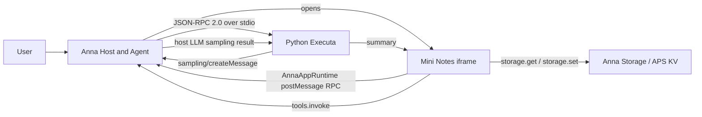
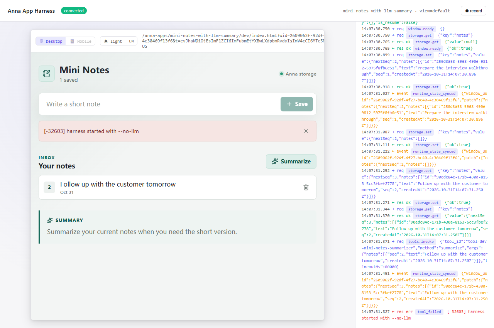

# Mini Notes with LLM Summary

[](https://github.com/waghhhhhhhh/mini-notes-with-llm-summary/actions/workflows/release.yml)

[GitHub repository](https://github.com/waghhhhhhhh/mini-notes-with-llm-summary)

[Release v0.1.0](https://github.com/waghhhhhhhh/mini-notes-with-llm-summary/releases/tag/v0.1.0)

A React frontend and Python Executa for an Anna App. Notes are read
and written through `anna.storage.*`; summaries are requested through
`anna.tools.invoke` and generated by the Executa through reverse-RPC
`sampling/createMessage`.

## Architecture



## Structure

```text
src/                                  React UI and Anna Host API adapters
executas/mini-notes-summarizer/       Python JSON-RPC over stdio plugin
tests/                                Unit, harness, protocol, and binary smoke tests
fixtures/sampling/                    Mock sampling response used by Executa dev
scripts/build_binary.py               Local binary archive builder
manifest.json                         Anna App manifest
```

## Setup

```bash
pnpm install
pnpm setup:python
pnpm sync:python
pnpm build
pnpm validate
```

pnpm uses `.pnpm-store` and `.pnpm-cache` inside this repository. uv uses
`.cache/uv`, its managed Python and tool directories also live under
`.cache/`, and all Python commands run through the project-local `.venv`.
Global package and cache locations are not used.

`pnpm build` generates the `bundle/` directory referenced by
`manifest.json`.

## Local App harness

```bash
pnpm anna:dev
```

The script pins the harness slug to `mini-notes-with-llm-summary`, matching
`app.json`. This is required by the current CLI because it otherwise derives
the development URL from the manifest display name.

The UI harness uses legacy in-memory `runtime_state`. With `--no-llm`,
Summarize still calls `anna.tools.invoke`, but host sampling is unavailable.
The expected result is an error such as
`[-32603] harness started with --no-llm`. The UI must not substitute a local
summary in that case.

The manifest grants `llm.complete` because the current local harness routes
Executa reverse sampling through the same Host API ACL as iframe calls. The
frontend does not call `anna.llm.*`; a regression test enforces that boundary.

In the harness RPC log, creating or deleting a note shows `storage.set` and
reloading the iframe shows `storage.get`. Summarize shows `tools.invoke`.

## Tests

Run all local checks:

```bash
pnpm test
```

This runs:

- Vitest unit tests for the notes model, storage adapter, tool arguments, error
  handling, and forbidden frontend bypasses.
- A release metadata check that keeps App, package, Executa, Python, and binary
  version declarations aligned.
- The stdlib Executa protocol test.
- A real `anna-app dev --no-llm` integration test that verifies `storage.set`,
  `storage.get`, `tools.invoke`, and the expected sampling error.
- A Playwright browser test that creates and deletes notes in the real harness,
  clicks Summarize, checks the RPC log, and verifies the expected no-LLM error.

The browser test can also be run on its own:

```bash
pnpm test:browser
```

The captured browser-test evidence shows the note, RPC activity, and expected
sampling error:



The stdlib protocol tests verify `initialize`, `describe`, `invoke`, concurrent
invokes, out-of-order sampling responses, and identity consistency across the
App manifest, frontend constant, Executa config, and plugin manifest without an
Anna account:

```bash
pnpm test:executa
```

Backend mock sampling is intended to run with:

```bash
pnpm executa:dev
```

The wrapper invokes the plugin with `sampling/createMessage` mocked from
`fixtures/sampling/create-message.jsonl`; no Anna account or network is
required. The fixture can only match after the Tool emits the reverse request,
so receiving its summary demonstrates that sampling was initiated. The protocol
test additionally asserts the exact `sampling/createMessage` method and
`metadata.executa_invoke_id`.

Manual JSON-RPC smoke test for `initialize` and `describe`:

```bash
printf '%s\n' \
  '{"jsonrpc":"2.0","id":1,"method":"initialize","params":{"protocolVersion":"2.0"}}' \
  '{"jsonrpc":"2.0","id":2,"method":"describe"}' \
  | node scripts/run-python.mjs executas/mini-notes-summarizer/mini_notes_summarizer.py
```

Manual `invoke` through the Anna Executa harness:

```bash
pnpm exec anna-app executa dev \
  --dir executas/mini-notes-summarizer \
  --mock-sampling fixtures/sampling/create-message.jsonl \
  --invoke summarize \
  --args '{"notes":[{"seq":1,"text":"Follow up with the customer tomorrow."}]}' \
  --json
```

The returned summary must match the fixture text. To verify the complete UI
chain, the harness RPC log must show `tools.invoke`; App replies cannot create
the summary themselves.

## Binary packaging

The build script detects the native platform, checks that all source versions
match, builds a PyInstaller executable, adds the install `manifest.json`,
creates the required archive, and runs a JSON-RPC smoke test:

```bash
pnpm build:binary
```

Use `pnpm build:binary` after `pnpm setup:python && pnpm sync:python` so the
build runs from the project virtual environment.

The default version is `0.1.0`. Pass a Semantic Version for a release build:

```bash
node scripts/run-python.mjs scripts/build_binary.py --version 1.2.3
```

The version is embedded in the Executa `describe` response and the archive
root `manifest.json`. Release assets are written to
`executas/mini-notes-summarizer/dist/assets/`.

Before publishing or cutting a release, synchronize every source version:

```bash
node scripts/run-python.mjs scripts/prepare_release.py --version 1.2.3
node scripts/run-python.mjs scripts/prepare_release.py --check --version 1.2.3
```

GitHub Actions verifies the App, unit harness and protocol tests, builds
`darwin-arm64`, `darwin-x86_64`, and `windows-x86_64`, checks every archive's
identity, version, and entrypoint, then attaches the archives to a GitHub
Release. `workflow_dispatch` uses its `version` input; tag pushes derive the
version from the tag after removing an optional leading `v`.

The `v0.1.0` workflow completed successfully. All three public Release assets
were downloaded again and matched GitHub's published SHA-256 digests.

## How the pieces fit

`manifest.json` declares the UI bundle, required Executa identity, storage and
tool access, and the App's sampling capability. The built bundle is the iframe
UI. Notes use Anna storage, which is APS KV in production and legacy in-memory
`runtime_state` under `anna-app dev`. Summarize crosses the Host API through
`anna.tools.invoke`, enters the stdio Executa, then returns through a reverse
`sampling/createMessage` request. The binary archive contains the packaged
Executa plus its install-time `manifest.json`.
