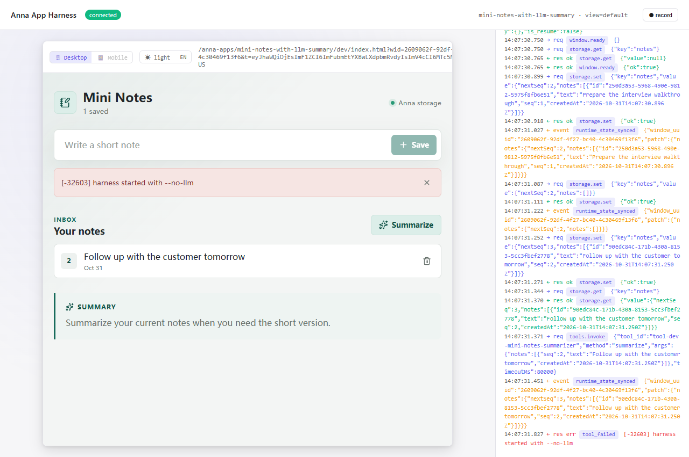

# Mini Notes Evidence

## Browser flow

`pnpm test:browser` starts the real `anna-app dev --no-llm` harness and verifies:

- A note is created and shown with its sequence number.
- The input is cleared after saving.
- A note is deleted and the empty state appears.
- The harness RPC log contains `storage.get`, `storage.set`, and `tools.invoke`.
- Summarize returns `[-32603] harness started with --no-llm`.

The committed screenshot was captured by that test after the full interaction:

## Protocol and mock sampling

- `pnpm test:executa` asserts that the Tool emits
  `sampling/createMessage`, carries `metadata.executa_invoke_id`, reads the
  reverse response, and returns the sampled summary.
- `pnpm executa:dev` runs the Tool against
  `fixtures/sampling/create-message.jsonl` and returns the fixture summary.

## Binary

- `pnpm build:binary -- --version 0.1.0` writes the Windows archive under
  `executas/mini-notes-summarizer/dist/assets/`.
- The build smoke test checks the binary's `initialize` and `describe`
  responses.
- `tests/verify_release_assets.py` checks the three release archives, including
  their root `manifest.json`, version, and entrypoint.
